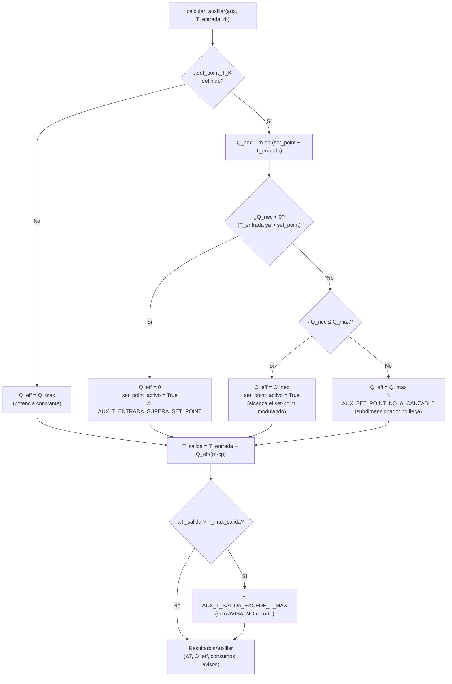
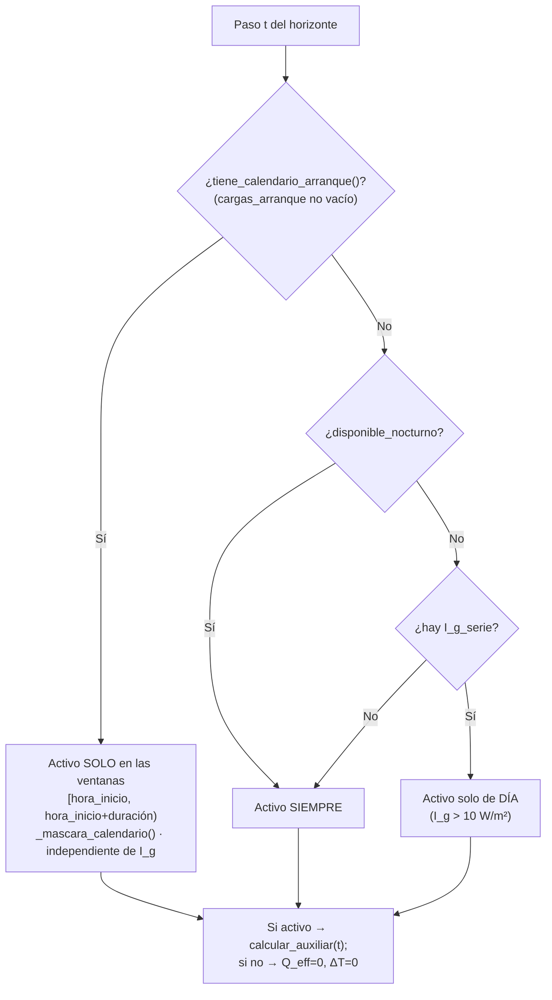
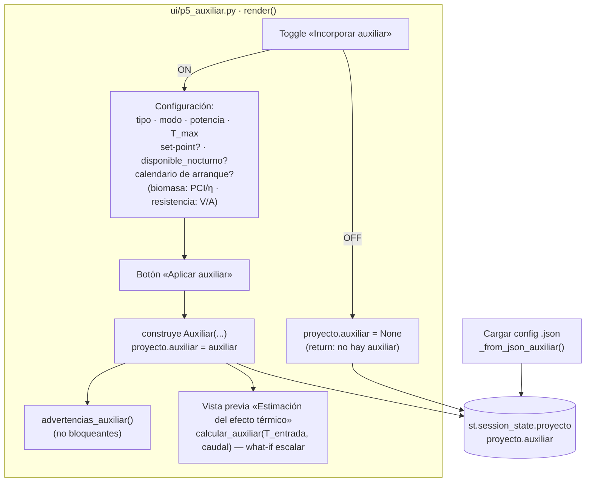
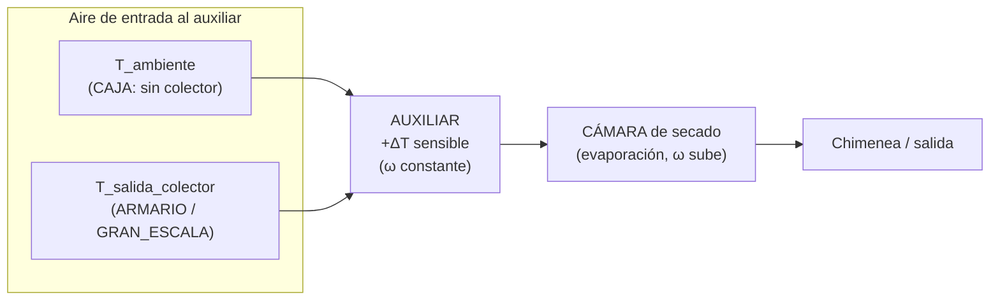
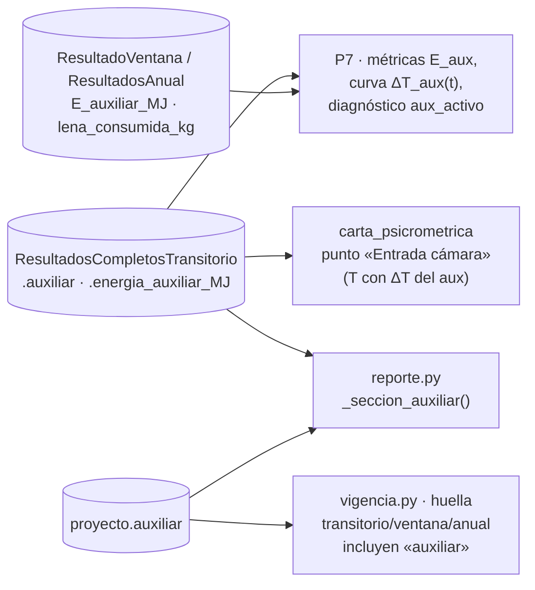

# Mapa del sistema auxiliar (calentamiento de respaldo)

Mapa detallado de **cómo el sistema de calentamiento auxiliar se interrelaciona
con el resto del proyecto**: qué scripts lo definen, cuál es su física, cómo se
activa, cuándo opera, y cómo interactúa con el usuario y con los demás módulos.

Complementa a [[mapa_conexiones]] (mapa general widget → campo → consumidor) con
foco exclusivo en el auxiliar.

> **Alcance físico (leer primero).** El auxiliar es un **calentador sensible del
> aire**, en régimen **estacionario y sin inercia térmica**. NO evapora agua, NO
> cambia la humedad absoluta ω del aire: solo le **sube la temperatura**. Su
> único efecto físico es un **ΔT** sobre el aire que entra a la cámara.

---

## 1. Scripts y responsabilidades

| Capa | Script | Qué define |
|------|--------|------------|
| **Datos** | `core/auxiliar.py` | `Auxiliar` (dataclass), enums `TipoAuxiliar` / `ModoOperacionAuxiliar`, `CargaArranque`, validaciones duras, `advertencias_auxiliar()` |
| **Física** | `calculos/auxiliar_calc.py` | `calcular_auxiliar()` (escalar), `calcular_auxiliar_transitorio()` (horizonte), `_mascara_calendario()`, `CP_AIRE = 1007 J/kg·K` |
| **Orquestación** | `calculos/balance_global.py` | Inyección del aux en los 3 pipelines (Constantes / Transitorio / Ventana) |
| **UI** | `ui/p5_auxiliar.py` | Toggle, configuración, "Aplicar auxiliar", vista previa del efecto térmico, (de)serialización `.json`/`.txt` |
| **Consumo** | `ui/p7_resultados.py` | Métricas `E_auxiliar_MJ`, curva `ΔT_aux(t)`, diagnóstico `aux_activo` |
| **Consumo** | `ui/reporte.py` | `_seccion_auxiliar()` en el PDF |
| **Consumo** | `ui/componentes/vigencia.py` | El auxiliar entra en la **huella** de los derivados transitorio/ventana/anual (no en la del horizonte) |
| **Consumo** | `calculos/carta_psicrometrica.py` | El punto "Entrada cámara" incluye el ΔT del auxiliar |
| **Consumo** | `calculos/simulacion_ventana.py`, `calculos/simulacion_anual.py` | Acumulan `E_auxiliar_MJ`, `lena_consumida_kg` |

---

## 2. La física (motor `auxiliar_calc.py`)

### 2.1 Balance de energía

Régimen estacionario, sin inercia. La potencia térmica entregada al aire produce
un salto de temperatura:

```
Q_eff = ṁ_aire · cp_aire · (T_salida − T_entrada)
  ⇒  T_salida = T_entrada + Q_eff / (ṁ_aire · cp_aire)
```

con `cp_aire = 1007 J/(kg·K)` **constante** (aire a ~50 °C). El aire **no gana
vapor**: ω_salida = ω_entrada (calentamiento sensible puro).

### 2.2 Potencia efectiva y control de set-point

`Q_max = potencia_nominal_W · fraccion_potencia_operacion`. Si NO hay set-point,
`Q_eff = Q_max` (potencia constante). Si hay set-point, el modelo asume **control
proporcional ideal**:



**Gotchas físicos a tener presentes:**

- **`T_max_salida` NO se recorta**, solo emite `AUX_T_SALIDA_EXCEDE_T_MAX`. El
  ΔT calculado se usa igual aguas abajo.
- **`cp_aire` es constante** (1007 J/kg·K), a diferencia del colector/cámara que
  usan propiedades del aire variables con T.
- **Sin inercia térmica**: el auxiliar reacciona instantáneamente al aire
  entrante en cada paso (modelo cuasi-estacionario, paso a paso).

### 2.3 Tipo de fuente y consumos

| Tipo | Consumo | Fórmula |
|------|---------|---------|
| `RESISTENCIA_ELECTRICA` | eléctrico | `consumo_electrico_W = Q_eff` (η ≈ 1) |
| `QUEMADOR_BIOMASA` | leña | `leña_kg = E_aux_MJ / (PCI_MJ_kg · η_quemador)` |

### 2.4 Solver transitorio (`calcular_auxiliar_transitorio`)

Recorre el horizonte paso a paso reusando `calcular_auxiliar` escalar. Devuelve
series `T_salida(t)`, `ΔT(t)`, `Q_eff(t)` + acumulados (`E_aux_MJ` por
`∫Q dt`, `horas_activo_s`, `lena_consumida_kg`). Agrega las advertencias **por
código** (no por string), para no inundar con cientos de avisos idénticos sobre
un año.

---

## 3. Cuándo opera el auxiliar (máscara temporal)

En el pipeline transitorio/ventana, cada paso decide si el auxiliar está activo:



| Configuración | Cuándo opera |
|---------------|--------------|
| `cargas_arranque` con ventanas | Solo en esas ventanas horarias (híbrido mañana/tarde estilo ADITAL). **Independiente del sol.** |
| `disponible_nocturno = True` | Siempre (24 h) |
| `disponible_nocturno = False` + hay `I_g` | Solo de día (I_g > 10 W/m²) |
| `disponible_nocturno = False` sin `I_g` | Siempre (fallback) |

---

## 4. Cómo se activa: interacción con el usuario (P5)



**Puntos clave de la interacción:**

- El toggle en OFF **borra** `proyecto.auxiliar` (lo pone en `None`).
- La **vista previa** de P5 (`calcular_auxiliar` escalar) es un **what-if
  aislado**: pide una `T_entrada` y un caudal, y NO es lo que se usa en el
  cálculo real. La verdad la calculan los pipelines de P7 con el aire real.
- El auxiliar **no tiene botón de cálculo que impacte P7**: se guarda en el
  proyecto y P7 lo consume al correr su pipeline.

---

## 5. Cómo se enchufa en el cálculo (los 3 pipelines de `balance_global`)

El auxiliar es siempre un **ΔT sensible sobre la temperatura del aire que entra
a la cámara**. Dónde nace ese aire cambia por tipología:



Circuito canónico (doc de balance §7): **ambiente → [colector] → auxiliar →
cámara → [chimenea] → salida.**

```mermaid
flowchart TD
    subgraph CONST["Modo CONSTANTES · calcular_todo()"]
        C1["_resolver_aux_cam_const()"]
        C1 --> C2["calcular_auxiliar(T_sal_colector, caudal)<br/>escalar"]
        C2 --> C3["T_ent_camara = T_sal_aux<br/>→ calcular_camara()"]
        C3 --> C4["res.energia_auxiliar_MJ = Q_eff · t_secado"]
    end
    subgraph TR["Modo TRANSITORIO · calcular_todo_transitorio()"]
        T1["_correr_aux_y_armar_forzantes()"]
        T1 --> T2["calcular_auxiliar_transitorio(<br/>T_sal_col_base(t), I_g(t))"]
        T2 --> T3["T_ent_camara(t) = T_sal_col(t) + ΔT_aux(t)"]
        T3 --> T4["res.auxiliar = aux_tr<br/>res.energia_auxiliar_MJ = E_aux_MJ"]
    end
    subgraph VEN["Modo VENTANA/ANUAL · armar_forzantes_ventana()"]
        V1["solo si modo == SERIE_POSCOLECTOR"]
        V1 --> V2["calcular_auxiliar_transitorio(<br/>T_post_caño(t), I_g(t), hora_offset)"]
        V2 --> V3["T_ent(t) = T_post_caño(t) + ΔT_aux(t)<br/>diagnósticos: E_aux_MJ, Q_aux_W_serie, leña"]
    end
```



| Pipeline | Punto de entrada | T que recibe el aux | ¿Filtra por `modo_operacion`? |
|----------|------------------|---------------------|-------------------------------|
| **Constantes** | `_resolver_aux_cam_const` | `T_salida_colector` (o T_amb si no hay colector) | **No** — aplica si `auxiliar is not None` |
| **Transitorio** | `_correr_aux_y_armar_forzantes` | `T_sal_col_base(t)` (chimenea o no; el mismo helper) | **No** — aplica si `auxiliar is not None` |
| **Ventana/Anual** | `armar_forzantes_ventana` | `T_post_caño(t)` (después del caño maestro) | **Sí** — solo `SERIE_POSCOLECTOR` |

**Modo RESPALDO (desde S62).** No aplica ΔT sobre `T_ent`. Su ruteo es:

| Pipeline | Cómo entra `Q_aux` | Contabilidad |
|----------|--------------------|--------------|
| **Constantes** | escalar `Q_aux_max_W` + `T_set_aux_K` a `calcular_camara` | `∫Q_aux dt` del motor, **fuera** del gate de convergencia (la energía existe aunque el lote no termine) |
| **Transitorio** | serie `forzantes.Q_aux_max_W`, enmascarada con `auxiliar_calc.mascara_disponibilidad` | ídem, vía `res.camara.energia_aux_total_J` |
| **Ventana/Anual** | no aplica (respaldo es CAJA/ARMARIO; esos modos van por el transitorio) | — |

Dos consecuencias que no son obvias:

- **El respaldo refuerza el tiro.** Con bocas o chimenea, más `Q_aux` ⇒ más `T_flujo`
  ⇒ más empuje ⇒ más caudal. Por eso `estimar_T_flujo_estacionario` también recibe
  `Q_aux_max_W`: sin eso el auxiliar calentaba pero el lazo natural resolvía el mismo
  caudal que sin auxiliar. Medido en un cajón con bocas de 0.05 m²: ṁ pasa de 0.0124
  a 0.0633 kg/s entre 0 y 3000 W.
- **La potencia contabilizada es la entregada, no la disponible.** Con set-point el
  motor modula (`Q_aux = clamp(T_set·den − num_base, 0, Q_max)`), así que integrar el
  techo sobrestimaría el consumo.

> **✅ CERRADA en S62.** Hasta S61 el auxiliar aplicaba su ΔT **sin mirar
> `modo_operacion`** en Constantes y Transitorio (trataba `RESPALDO_INDEPENDIENTE`
> igual que `SERIE_POSCOLECTOR`), así que el modo respaldo no tenía física propia:
> elegirlo no cambiaba ningún número.
>
> Ahora **la tabla de arriba vale solo para `SERIE_POSCOLECTOR`**. En respaldo el
> auxiliar no entra por la columna "T que recibe el aux" porque no hay tal cosa:
> la fuente está **dentro de la cámara** y su potencia se inyecta en el **nodo de
> aire** del balance (`resolver_estado_camara(..., Q_aux_max_W, T_set_aux_K)`),
> en el mismo renglón que `Q_rad_aire_W`. Ver §2.2 del spec.

---

## 6. Quién consume el resultado del auxiliar



**Vigencia (huella).** El auxiliar entra en la huella de los derivados
**transitorio**, **ventana** y **anual** (`_SECCIONES_AIRE + ("auxiliar", ...)`):
cambiar el auxiliar después de calcular marca esos resultados como
desactualizados. **No** entra en la huella del **horizonte** de P4, porque las
forzantes del horizonte son el aire **antes** del auxiliar (P7 le suma el ΔT
recién al correr su pipeline).

---

## 7. Resumen de campos (`core/auxiliar.py::Auxiliar`)

| Campo | Default | Rol |
|-------|---------|-----|
| `tipo` | `RESISTENCIA_ELECTRICA` | Fuente de calor |
| `modo_operacion` | `SERIE_POSCOLECTOR` | En serie con el colector vs respaldo independiente |
| `potencia_nominal_W` | 1000 | Potencia térmica nominal |
| `temperatura_maxima_salida_K` | 343.15 (70 °C) | Límite de seguridad (solo avisa) |
| `set_point_T_K` | `None` | T objetivo; `None` = potencia constante |
| `fraccion_potencia_operacion` | 1.0 | Fracción de la nominal |
| `disponible_nocturno` | `False` | Puede operar sin sol |
| `cargas_arranque` | `[]` | Ventanas horarias del híbrido mañana/tarde |
| `PCI_MJ_kg`, `eficiencia_quemador`, `tipo_biomasa`, `consumo_biomasa_kg_h` | `None` | Solo biomasa |
| `tension_V`, `corriente_maxima_A` | `None` | Solo resistencia |

**Validaciones duras** (`__post_init__`): potencia > 0; T_max ∈ [0, 200 °C];
set_point ≤ T_max; fracción ∈ [0, 1]; biomasa requiere PCI o consumo, y si hay
PCI requiere η.

---

## Ver también

- [[mapa_conexiones]] — mapa general widget → campo → consumidor.
- `docs/notas/balance de calor y masa en camara ampliado.md` — circuito de aire
  (§7): ambiente → colector → auxiliar → cámara → chimenea.
- [[docs/arquitectura]] — capas y subsistemas.
