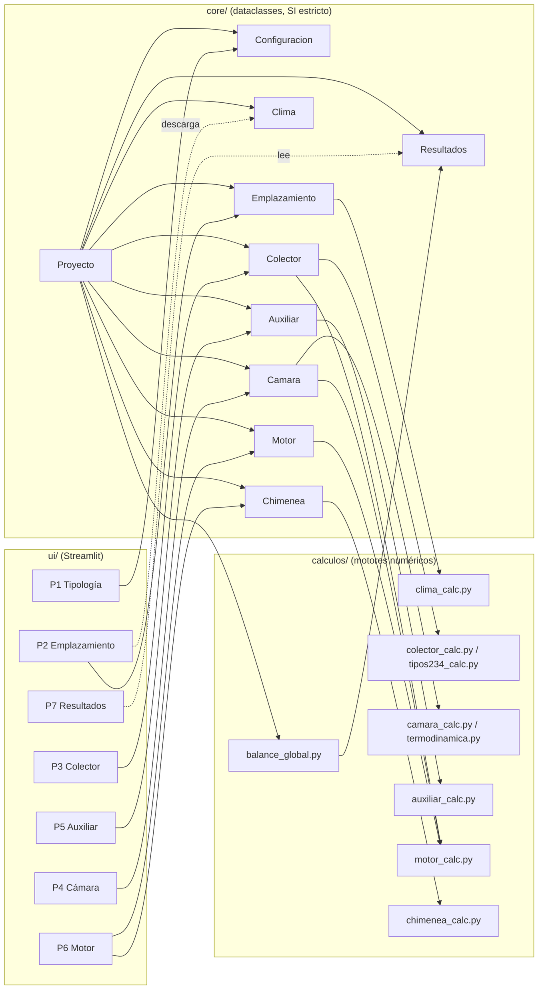
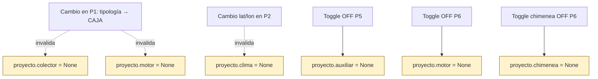
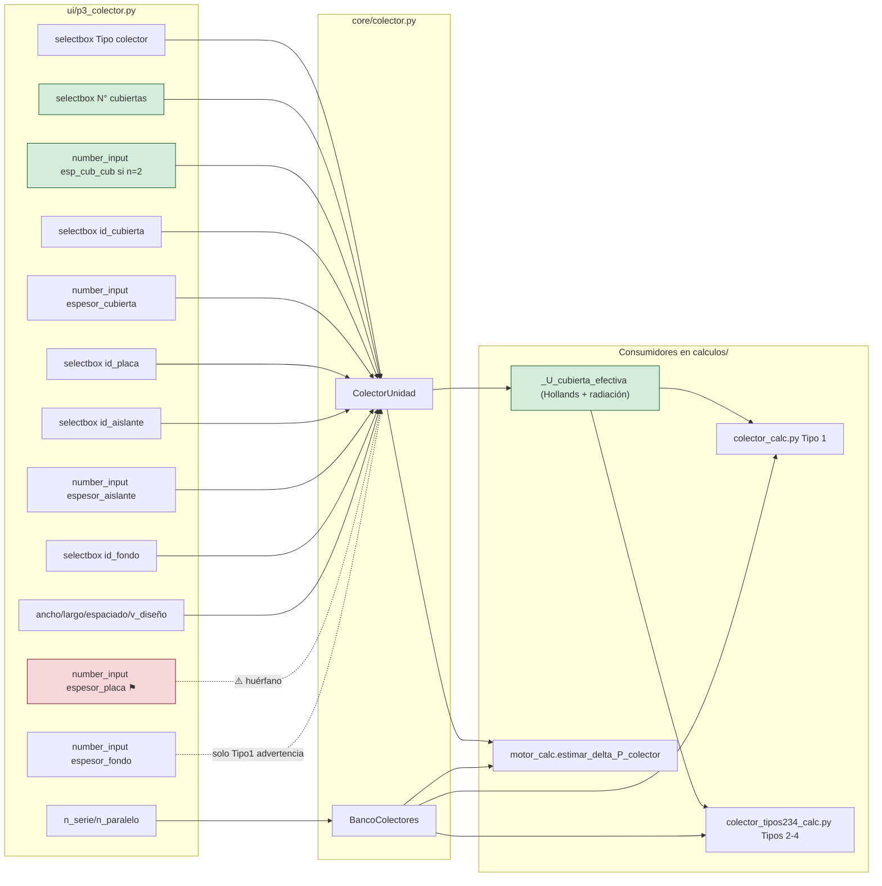
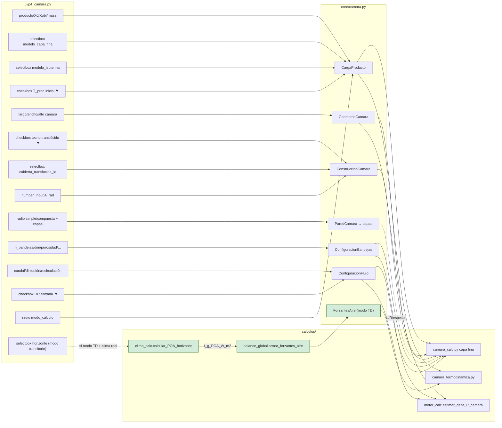
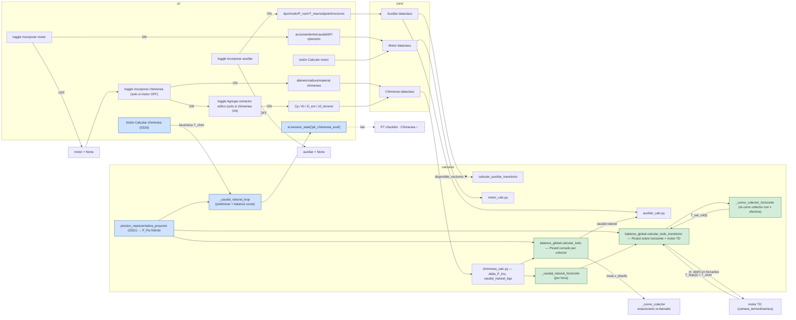
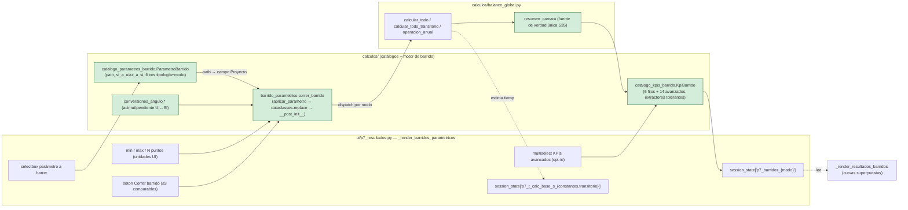

# Mapa de conexiones — Secasol

> Documento auto-generado el 2026-05-19 (revisado al cierre de S30 extendida 2026-05-20, S31 2026-05-21, S32 2026-05-22, S34 2026-05-29, S35 2026-06-01).
> Objetivo: detectar **widgets UI sin consumidor en `calculos/`** y **campos consumidos sin widget UI** (toggles/inputs huérfanos).
>
> S33 (deploy a HF Spaces) no introdujo cableado widget→campo→consumidor: ver `docs/bitacora/bitacora_sesion33.md`.

---

## Resumen ejecutivo

Una desconexión real (eran 3 a inicio de S30):

| # | Widget UI | Campo escrito | Estado |
|---|-----------|---------------|--------|
| 1 | "Espesor placa absorbedora [mm]" (P3) | `proyecto.colector.unidad.espesor_placa_m` | ⚠️ No es leído por ningún cálculo térmico (se asume capacitancia despreciable). Decisión consciente de no incorporar capacitancia de placa por ahora. |

**Corregido en S30 (2026-05-19):**

- **"N° cubiertas" (P3)**: propagado a los 4 motores numéricos vía `_U_cubierta_efectiva` (Hollands + radiación gris paralela). Acompañó la corrección de dos bugs preexistentes en los signos del residual `_sistema_nodo` (F1 en los 4 tipos, F3 en Tipo 1) que producían raíces espurias con `T_cub_e` físicamente imposibles. Ver `validacion/validacion_hwb.py`.
- **F4 Tipos 2/3/4**: agregado el término convectivo `conv_ci_int = h·(T_int − T_f_ci)·W_abs` al balance de la cara interna del fondo, restaurando coherencia local con la EDO del fluido inferior (que ya lo cobraba). Ver `validacion/comparar_f4.py`.
- **Chimenea solar**: el huérfano se cerró completo en 4 pasos. (a) Nuevo `calculos/chimenea_calc.py` con `delta_P_tiro_Pa`, `delta_P_chimenea_Pa`, `caudal_natural_kgs` (tiro térmico + brentq sobre equilibrio). (b) Migrada estructuralmente de `Colector` a `Proyecto` top-level (nuevo `core/chimenea.py`) para que también aplique a tipología CAJA. (c) UI propia en **P6** (Motor), accesible cuando el toggle de motor está OFF. (d) Integrada en `balance_global.calcular_todo`: cuando motor=None y chimenea presente, el caudal natural reemplaza al caudal manual de la cámara durante la simulación (try/finally restaura).

**Completado en S30 extendida (2026-05-19/20)** — cierre físico completo del lazo natural:

- **Visualización en P7 modo constantes**: panel dedicado, tabla expander con 8 filas, warning explícito si desviación |ṁ_nat − ṁ_design|/ṁ_design > 30 %, snapshots `.txt`/`.json` con bloque chimenea.
- **Picard cerrado por el colector en modo constantes**: `calcular_todo` itera T_chim ↔ ṁ_nat ↔ T_salida_colector mutando `velocidad_diseno_ms` del colector en cada paso (try/finally restaura). 10 iter máx, tol 0.5 K. Demo: converge en 7 iter; ṁ_nat ~55 % menor que el single-pass original (que sobreestimaba con v de diseño).
- **Acople transitorio con motor TD**: `calcular_todo_transitorio` corre Picard sobre el horizonte (5 iter máx). `m_dot_aire_seco_kg_s` ya era array en `ForzantesAire`; el motor TD interpola por t. Auxiliar transitorio recibe ṁ promedio del horizonte (limitación de primer orden documentada). `ResultadosCompletosTransitorio.chimenea` poblado con series horarias.
- **Re-corrida del colector hora a hora**: nuevo `_correr_colector_horizonte` itera el solver del colector cada hora con v efectiva `ṁ_nat(t) / (ρ · A_canal · n_par)`. Cambia T_sal_col(t) ~−15 °C respecto a la forzante UI precomputada con velocidad de diseño (en escenarios donde ṁ_nat ≠ ṁ_design).
- **POA precomputada en `ForzantesAire`**: nuevo campo `I_g_POA_W_m2` (opcional). Helper compartido `calculos/clima_calc.calcular_POA_horizonte` aplica transposición Liu-Jordan con pvlib (mismo modelo que P3, ahora deduplicado). P4 puebla la POA desde clima real; el sugerido de I_g en P7 modo constantes ahora sale de quantile 90 de POA. Si POA no está disponible (forzante sintética, clima incompleto), el balance global cae a GHI con aviso explícito `ADV_PICARD_POA_NO_DISPONIBLE`.

Todas las demás conexiones revisadas (toggles de auxiliar, motor, cubierta translúcida, pared compuesta, HR de entrada, T_prod inicial, etc.) están correctamente cableadas.

---

## Diagrama 1 — Arquitectura general (3 capas)

**Regla arquitectónica**: `core/` y `calculos/` no importan `streamlit`. La conversión de unidades **físicas** (°C↔K, kPa↔Pa, %↔fracción) ocurre en `ui/componentes/unidades.py`. Desde S35 las conversiones de **ángulos** (Duffie↔UI360↔pvlib) son matemática pura y viven en `calculos/conversiones_angulo.py` (fuente de verdad única, consumida por `clima_calc` y por el catálogo de barridos); `unidades.py` las **re-exporta** por compatibilidad con la UI histórica. Nunca duplicar la fórmula.

---

## Diagrama 2 — Cascada de invalidación

---

## Diagrama 3 — P3 Colector (estado final S30)

**Hallazgos P3 (actuales)**:
- `n_cubiertas` + `espaciado_entre_cubiertas_m`: ✓ Conectados a los 4 motores numéricos vía `_U_cubierta_efectiva` (corrección S30, 2026-05-19). La doble cubierta agrega resistencia serie cubierta–cavidad–cubierta usando Hollands + radiación entre superficies grises paralelas.
- `espesor_placa_m`: ⚠️ Configurable pero no entra al balance térmico. El modelo asume capacitancia despreciable de la placa.
- **Chimenea**: ya no está en P3. Se migró a `Proyecto.chimenea` (top-level, definida en `core/chimenea.py`) y su UI vive en P6.

---

## Diagrama 4 — P4 Cámara

**Hallazgos P4 (estado al cierre de S32)**:

- Todas las conexiones de cámara (dataclasses → solvers) cableadas correctamente. La pared compuesta se consume vía métodos agregados (`U_conduccion_W_m2K`, `R_conduccion_m2K_W`, `espesor_total_m`) en `camara_calc.py:735`.
- **Modo transitorio**: P4 arma `ForzantesAire` desde el clima horario real. Ahora la forzante incluye **dos series de irradiancia separadas**:
  - `I_g_W_m2`: GHI sobre el techo de la cámara (input al motor termodinámico de cámara para Q_rad por techo translúcido).
  - `I_g_POA_W_m2`: POA sobre el plano del colector (input a `_correr_colector_horizonte` cuando el lazo natural por chimenea está activo). Calculada con `calculos.clima_calc.calcular_POA_horizonte` (transposición Liu-Jordan con pvlib, mismo modelo que P3).
- Si DNI/DHI no están disponibles (clima incompleto, modo sintético), POA queda en `None` y el balance global cae a GHI con aviso explícito `ADV_PICARD_POA_NO_DISPONIBLE`.
- **"Día real" habilitado en CAJA (S32b)**: nuevo helper `_construir_forzantes_reales_caja` arma `ForzantesAire` desde clima NASA + `cfg.dia_analisis` directamente, con `T_salida_colector_K = T_amb_K` (la cámara *es* el colector). `_disponibilidad_forzantes_reales` ahora hace branch por tipología (CAJA exige sólo clima; ARMARIO/GRAN_ESCALA siguen exigiendo P3). El radio "Forzantes del aire de entrada" muestra label dinámico ("Día real (clima ambiente)" en CAJA / "Día real (clima + colector)" en el resto).
- **Presión atmosférica corregida por altitud (S32c)**: el botón "Calcular" computa `P_proyecto_Pa` vía `presion_representativa_proyecto` y lo propaga a `_construir_forzantes_termodinamico` (ω desde HR y T_amb) y a `calcular_camara` (modos capa fina y termodinámico). Caption visible con el origen del valor.

---

## Diagrama 5 — P5 Auxiliar + P6 Motor / Chimenea (toggles raíz)

**Hallazgos P5/P6 (estado al cierre de S32)**:

- Toggle `disponible_nocturno` del auxiliar solo afecta al modo transitorio (`calcular_auxiliar_transitorio`); en modo cuasi-estacionario es ignorado — comportamiento esperado.
- Chimenea en P6 (sólo si motor OFF): estructuralmente coexisten en el dataclass, son mutuamente excluyentes desde la UI.
- **Lazo natural cerrado en ambos modos** (desde S30 extendida):
  - *Constantes*: Picard `T_chim ↔ ṁ_nat ↔ T_sal_col` en `calcular_todo`. Re-corre el colector estacionario mutando `velocidad_diseno_ms`. 10 iter máx, tol 0.5 K. Try/finally restaura.
  - *Transitorio*: Picard sobre todo el horizonte en `calcular_todo_transitorio`. Por iteración: `_caudal_natural_horizonte` calcula ṁ(t) hora a hora; `_correr_colector_horizonte` re-corre el colector cada hora con v efectiva; motor TD consume las nuevas forzantes; `T_flujo(t)` realimenta T_chim(t). 5 iter máx, tol 0.5 K.
- **POA correcta en el solver del colector**: en ambos pipelines la radiación que entra al solver del colector es POA (no GHI). Ver §101 de la bitácora y diagrama 4 abajo.
- **Botón "Calcular chimenea" en P6 (S32d)**: resuelve `_caudal_natural_loop` con T_chim heurística (Tamb+25 K CAJA / +30 K ARMARIO) + condiciones representativas del clima. Persiste en `st.session_state["p6_chimenea_eval"]` para que P7 marque el checklist como ✅. **Los números son preliminares**: P7 vuelve a resolver con Picard completo.
- **Presión atmosférica corregida por altitud (S32c)**: `presion_representativa_proyecto` (helper público en `balance_global.py`) propagada a `_resolver_aux_cam_const`, `_correr_colector(_horizonte)`, `_caudal_natural_loop`/`_horizonte`. También consumida directamente desde `ui/p4_camara.py` (botón Calcular) y `ui/p6_motor.py` (estimar_delta_P_*, delta_P_tiro_Pa, delta_P_turbina_motriz_Pa).

---

## Diagrama 6 — P7 Corridas paramétricas (barridos, S35)

Patrón **inverso** al resto del mapa: los widgets de barrido **no escriben en `Proyecto`**. Seleccionan, desde un catálogo curado, **un campo existente del `Proyecto`** (o una forzante) para barrerlo en N puntos sin mutar el proyecto persistente. El estado es **efímero** (`session_state`, no se serializa al JSON).

**Hallazgos P7 barridos (S35)**:

- **Sin huérfanos nuevos**: cada `path` del catálogo (`camara.flujo.caudal_masico_kg_s`, `colector.unidad.largo_m`, `colector.banco.n_serie/n_paralelo`, `emplazamiento.{pendiente,acimut}_colector_deg`, `camara.carga_producto.*`, `camara.geometria.*`) apunta a un campo **ya cableado** del `Proyecto`. El barrido los lee y los reescribe vía `dataclasses.replace` (regatilla `__post_init__` → revalida). Las forzantes (`forzante:HR_camara`, `forzante:T_amb`, solo modo Constantes) devuelven override sin tocar el proyecto.
- **Filtrado por tipología y modo**: `parametros_para_tipologia` oculta parámetros no aplicables. `pendiente`/`acimut` solo en `{transitorio, anual}` (en Constantes la POA es input directo, no se recalcula). El sweep de ángulos se construye en unidades de UI (`linspace` UI → `ui_a_si` por punto) para sortear la no-monotonía del acimut — usa `conversiones_angulo` (S35).
- **`resumen_camara` (S35)**: fuente de verdad única para extraer `t_secado_s`/`masa_agua_kg`/`status`/`convergio` de las dos firmas de resultado de cámara. La consumen el barrido (`catalogo_kpis_barrido`), `balance_global._extraer_t_y_masa` (wrapper) y `p7_resultados._resumen_camara` (agrega conversión a horas en la frontera UI). Cualquier cambio en una firma de resultado se centraliza acá.
- **Tolerancia a fallos**: un punto que lanza `ValueError`/`RuntimeError` (ej. `n_paralelo=0`) deja un **hueco** en la curva, no aborta el barrido. KPIs no aplicables al modo se extraen como `None` (`getattr` con default).
- **Estado efímero**: los barridos viven en `session_state['p7_barridos_{modo}']` y **no se persisten** en el JSON/TXT/PDF del proyecto. La estimación de tiempo usa una base stasheada en `p7_t_calc_base_s_{constantes,transitorio}` tras cada cálculo normal.

---

## Tabla maestra — widget → campo → consumidor

| Pestaña | Widget UI | Campo `Proyecto.*` | Leído por |
| ------- | --------- | ------------------- | --------- |
| P1 | tipología (radio) | `configuracion.tipologia` | `balance_global` |
| P1 | modo_analisis | `configuracion.modo_analisis` | `balance_global` |
| P1 | dia_analisis (7 valores: `SOLSTICIO_VERANO/INVIERNO`, `EQUINOCCIO_MARZO/SEPTIEMBRE` ← S32a, `MAS_CALUROSO`, `MAS_FRIO`, `ESPECIFICO`) | `configuracion.dia_analisis` | `ui/p2_emplazamiento._fecha_dia_analisis`, `ui/p3_colector._seleccionar_dia`, `ui/p4_camara._construir_forzantes_reales_caja` (S32b) |
| P2 | latitud/longitud | `emplazamiento.lat/lon_deg` | `clima_calc.obtener_clima` |
| P2 | altitud (display NASA + override usuario) | `emplazamiento.altitud_m` | `calculos.balance_global.presion_representativa_proyecto` (S32c → ISA cuando no hay clima) |
| P2 | acimut/pendiente | `emplazamiento.acimut/pendiente` | `solar_geometria` (vía emplazamiento) |
| **P3** (cross-tab) | albedo del suelo (selectbox superficies + personalizado) | `emplazamiento.albedo_suelo` | `clima_calc.calcular_POA_horizonte` (componente reflejada `GHI·ρ·(1−cosβ)/2` → POA → solver colector y todos los consumidores de POA). **Widget en P3, campo en Emplazamiento.** Reemplaza el `0.25` hardcodeado de pvlib. Catálogo en `calculos/catalogo_albedos.py`. |
| P2 | zona_horaria | `emplazamiento.zona_horaria` | `solar_geometria` |
| P3 | N° cubiertas ⚑ | `colector.unidad.n_cubiertas` + `espaciado_entre_cubiertas_m` | `colector_calc`, `tipos234_calc` (vía `_U_cubierta_efectiva`) |
| **P3** | **Espesor placa** ⚑ | `colector.unidad.espesor_placa_m` | **⚠️ ninguno** |
| P3 | id_cubierta/espesor_cubierta | `colector.unidad.*` | `colector_calc`, `tipos234_calc` |
| P3 | id_placa | `colector.unidad.id_placa` | `colector_calc`, `tipos234_calc`, `motor_calc` (rugosidad) |
| P3 | id_aislante/espesor_aislante | `colector.unidad.*` | `colector_calc`, `tipos234_calc` |
| P3 | id_fondo | `colector.unidad.id_fondo` | `tipos234_calc` (no Tipo 1) |
| P3 | geometría + banco | `colector.unidad/banco.*` | `colector_calc`, `tipos234_calc`, `motor_calc` |
| P4 | producto/X/masa/modelos | `camara.carga_producto.*` | `camara_calc`, `camara_termodinamica` |
| P4 | T_prod inicial | `camara.carga_producto.T_prod_inicial_K` | `camara_termodinamica` |
| P4 | geometría cámara | `camara.geometria.*` | `camara_calc`, `motor_calc` |
| P4 | techo translúcido + A_rad | `camara.construccion.*` | `camara_calc`, `camara_termodinamica` |
| P4 | pared compuesta (capas) | `camara.construccion.pared.capas` | `camara_calc` (vía métodos U/R) |
| P4 | bandejas (todo) | `camara.bandejas.*` | `camara_calc`, `motor_calc` |
| P4 | caudal/dirección/recirc/HR | `camara.flujo.*` | `camara_calc`, `motor_calc` |
| P4 | modo_calculo (radio; **default `termodinamico` desde S34**) | `camara.modo_calculo` | `camara_calc.calcular_camara` (dispatcher: selección de rama capa_fina/termodinámico) |
| P4 | batches_por_mes (slider, solo ANUAL) | `camara.operacion_anual.batches_por_mes` | `operacion_anual_camara.calcular_operacion_anual_camara` (escala mensual) |
| P4 → P7 | `ResultadosAnualCamara` (session_state) | `st.session_state["p4_resultado_anual"]` | `p7_resultados._render_operacion_anual_detalle` (tabla + barras 12 meses) |
| P5 | tipo/modo/P_nom/setpoint/T_max/η_quem/PCI | `auxiliar.*` | `auxiliar_calc` |
| P5 | disponible_nocturno ⚑ | `auxiliar.disponible_nocturno` | `calcular_auxiliar_transitorio` |
| P5 | tipo_biomasa/PCI/η | `auxiliar.*` | `auxiliar.consumo_biomasa_efectivo_kg_h()` |
| P6 | accionamiento/caudal/ΔP/η/factor | `motor.*` | `motor_calc`, `Motor.__post_init__` |
| P6 | chimenea (D, H, material) | `proyecto.chimenea.*` (top-level) | `chimenea_calc.{delta_P_tiro_Pa, caudal_natural_kgs}`, `balance_global._caudal_natural_loop` (constantes) y `_caudal_natural_horizonte` + `_correr_colector_horizonte` (transitorio, dentro de Picard) |
| P6 | extractor eólico en chimenea (`extractor_activo`, `diametro_extractor_m`, `Cp_turbina`, `Kt_turbina`, `z0_terreno_m`) | `proyecto.chimenea.{extractor_activo, ...}` | `chimenea_calc.{delta_P_turbina_motriz_Pa, _v_viento_a_altura, caudal_natural_kgs}` (motriz + Kt + perfil log de viento). Propagado a `_caudal_natural_loop`/`_caudal_natural_horizonte` con `v_viento_10m_ms` desde forzantes |
| P6 → P7 (S32d) | botón "Calcular chimenea" — resultado preliminar del lazo natural | `st.session_state["p6_chimenea_eval"]` (dict de `_caudal_natural_loop` con T_chim heurística) | `ui/p7_resultados._render_estado` (lee para marcar `P6 · Chimenea ✅` en checklist). El balance global de P7 **no lee este dict** — vuelve a resolver con Picard completo. |
| (interno, S32c) | presión atmosférica corregida por altitud | — (calculada de `clima.datos["presion_Pa"]` o `emplazamiento.altitud_m`) | `presion_representativa_proyecto` → `_resolver_aux_cam_const`, `_correr_colector(_horizonte)`, `_caudal_natural_loop`/`_horizonte`, `operacion_anual_camara._calcular_punto_mensual`, `ui/p4_camara` (botón Calcular), `ui/p6_motor` (estimar_delta_P_*, delta_P_tiro_Pa, delta_P_turbina_motriz_Pa) |
| P4→core | I_g_POA(t) sobre plano colector | `forzantes_base.I_g_POA_W_m2` (transitorio) | `balance_global._correr_colector_horizonte` → `_correr_colector` → `colector_calc`/`tipos234_calc` |
| P4→core | GHI(t) sobre techo cámara | `forzantes_base.I_g_W_m2` (transitorio) | `camara_termodinamica.simular_secado` (Q_rad por techo translúcido) |
| (interno) | POA representativa anual (sugerido P7) | — | `ui/p7_resultados._sugerir_condiciones` → `calcular_POA_horizonte` (quantile 90) |
| P7 (S35) | barrido: parámetro / rango / N / KPIs avanzados | **ningún campo `Proyecto`** (estado efímero `session_state['p7_barridos_{modo}']`) | `barrido_parametrico.correr_barrido` lee el `path` del `ParametroBarrido` seleccionado sobre una **copia** del proyecto (`dataclasses.replace`, sin mutar el persistente). KPIs vía `catalogo_kpis_barrido` + `balance_global.resumen_camara` |
| (interno, S35) | base de tiempo de cálculo para estimar barrido | — (`session_state['p7_t_calc_base_s_{constantes,transitorio}']`) | `ui/p7_resultados` stash tras cada `calcular_todo(_transitorio)` normal |

---

## Recomendaciones

Pendientes:

1. **`espesor_placa_m`**: documentar explícitamente que el modelo asume capacitancia térmica de la placa despreciable, o incorporar el término al EDO si la masa de la placa es relevante.
2. **A_rad configurable desde P4** (hoy default a `area_bandeja_m2` superior). Heredado de S29.
3. **α_solar por producto** en `frutas.yaml`/`hortalizas.yaml` (default 0.6). Heredado de S29.

✓ **Resueltos en S30 (2026-05-19):**

- **`n_cubiertas`** conectada a los 4 motores numéricos vía `_U_cubierta_efectiva`, junto con `espaciado_entre_cubiertas_m`.
- **Bugs preexistentes de signos** en F1 (los 4 tipos) y F3 (Tipo 1) del residual algebraico — raíz espuria con `T_cub_e ≈ −200 °C`. Validado contra HWB con R²=1.0000 (en S30, con propiedades del aire constantes; desde S36 el modelo usa propiedades variables y el R² es ≈0.999, ver nota de h local más abajo).
- **F4 Tipos 2/3/4**: incoherencia entre EDO del fluido ci y balance del fondo corregida agregando `conv_ci_int` explícito.
- **Chimenea solar**: cerrado el ciclo huérfano → modelo (`chimenea_calc.py`), migración a `Proyecto` top-level, UI propia en P6, integración del caudal natural en `balance_global` (single-pass).

✓ **Resueltos en S30 extendida (2026-05-19/20)** — completan el cierre físico del lazo natural:

- **Visualizar `res.chimenea` en P7 modo constantes**: panel, tabla, snapshots `.txt`/`.json` y warning explícito si la desviación |ṁ_nat − ṁ_design|/ṁ_design > 30 %.
- **Iterar T_chim ↔ ṁ_nat ↔ T_salida_colector** (Picard cerrado por el colector) en `calcular_todo` (modo constantes). 10 iter máx, tol 0.5 K. Mutación temporal de `velocidad_diseno_ms` con `try/finally`.
- **Acople con motor termodinámico de cámara** en pipeline transitoria (`calcular_todo_transitorio`): Picard sobre el horizonte completo (5 iter máx). `ResultadosCompletosTransitorio.chimenea` con series horarias. UI: Panel 5 de chimenea con ṁ(t), T_chim(t), ΔP_tiro(t).
- **Re-correr el colector hora a hora** dentro del Picard transitorio: nuevo `_correr_colector_horizonte` itera el solver estacionario con v efectiva impuesta por el ṁ_nat de cada hora. Coherencia energética en `energia_solar_util_MJ` con las series re-calculadas.
- **POA precomputada en `ForzantesAire`**: nuevo campo `I_g_POA_W_m2` opcional + helper compartido `calculos.clima_calc.calcular_POA_horizonte` (transposición Liu-Jordan con pvlib). P4 puebla la POA desde clima real. P3 deduplicado (su `_poa_serie` ahora es wrapper del helper). Sugerido de I_g en P7 modo constantes ahora sale de quantile 90 de POA. Fix del bug físico: los 4 solvers de colector reciben POA en todos los caminos (P3 horario/diario, P3/P7 constantes, P7 transitorio con clima). Fallback a GHI con aviso `ADV_PICARD_POA_NO_DISPONIBLE` sólo en forzantes sintéticas o clima sin DNI/DHI.

Ver `docs/bitacora/bitacora_sesion30.md` (§84-§101) y `validacion/{validacion_hwb,comparar_f4}.py`. Suite al cierre: **774 + 2 xfailed** (era 717 + 2 al cierre de S29; +57 tests netos en la sesión extendida).

✓ **Resueltos en S31 (2026-05-20/21)** — cierra dos tópicos de la hoja de ruta a 1.0:

- **K_rugosidad por bandeja con producto** (S31a, cierra "ΔP en bandejas"): nuevo campo `ConfiguracionBandejas.K_rugosidad_producto` (default auto desde tabla `d_p/espacio_libre`). En HORIZONTAL suma `K_rug · ρ·v_canal²/2 · n_bandejas`; en VERTICAL suma `K_TRANSICION_LECHO=1.5 · ρ·v₀²/2 · n_bandejas` (Ergun ya cubría la rugosidad del producto vía Φ_s, d_p). Tabla anclada en Idelchik / Crane TP-410.
- **Extractor eólico migrado a accesorio de chimenea** (S31b): eliminado `TipoAccionamiento.EXTRACTOR_EOLICO`; agregados `extractor_activo`/`Cp_turbina`/`Kt_turbina`/`z0_terreno_m`/`diametro_extractor_m` en `Chimenea`. Balance del lazo natural ampliado con término motriz `Cp·ρ·v_viento²/2` (corregido a la altura del tope por perfil log) + resistivo `Kt·ρ·v_extractor²/2`. Migración automática de `.json` viejos con `st.warning`.
- **Operación anual de cámara cascada A+B** (S31c, cierra "modo ANUAL de cámara"): módulo `calculos/operacion_anual_camara.py` con orquestador que corre motor TD sobre el día típico de cada mes (de `clima_calc.dia_tipo_mensual`). Las 4 eficiencias de Augustus Leon (RSER 2002) en `calculos/eficiencias_camara.py`. UI: en P4 sección "📅 Operación anual" **arriba** cuando `modo_analisis==ANUAL`, con batch puntual de día sintético como test secundario debajo. En P7 panel mensual al principio cuando hay resultado anual calculado.

Ver `docs/bitacora/bitacora_sesion31.md` (§121-§125). Suite al cierre de S31: **833 + 2 xfailed** (+59 tests netos desde S30).

✓ **Resueltos en S32 (2026-05-22)** — mejoras del modo CAJA + propagación física global:

- **Equinoccios separados** (S32a): el enum `DiaAnalisis` ahora tiene dos valores distintos `EQUINOCCIO_MARZO` (21/3) y `EQUINOCCIO_SEPTIEMBRE` (21/9), con labels que explicitan la estación en hem. sur. Antes el valor único `EQUINOCCIO` mapeaba siempre al 21 de marzo aunque el label decía "21 mar / 21 sep" — bug latente corregido. Rama nueva agregada en `_fecha_dia_analisis` (P2), `_seleccionar_dia` (P3) y `_construir_forzantes_reales_caja` (P4).
- **"Día real" habilitado en tipología CAJA** (S32b): nuevo helper `_construir_forzantes_reales_caja` en `ui/p4_camara.py` arma `ForzantesAire` desde clima NASA + `cfg.dia_analisis` sin requerir P3, con `T_salida_colector_K = T_amb_K` (la cámara *es* el colector). `_disponibilidad_forzantes_reales` ahora hace branch por tipología.
- **Presión atmosférica corregida por altitud** (S32c, propagada a cámara + colector + chimenea + motor): nuevo helper `presion_representativa_proyecto(proyecto) -> (P_Pa, origen)` en `calculos/balance_global.py` con política híbrida (media anual NASA POWER → ISA con `altitud_m` → 101 325 Pa). Propagado a `_resolver_aux_cam_const`, `_correr_colector(_horizonte)`, `_caudal_natural_loop`/`_horizonte`, `operacion_anual_camara._calcular_punto_mensual`, `ui/p4_camara.py` (botón Calcular) y `ui/p6_motor.py` (estimar_delta_P_*, delta_P_tiro_Pa, delta_P_turbina_motriz_Pa). Para Salta (~1187 m) P ≈ 88 kPa (no 101 kPa); ω_sat ~15 % más alta a igual T/HR. Pendiente: `core/motor.py:177` (ρ_descarga hardcoded a 101325).
- **Botón "Calcular chimenea" en P6** (S32d): nuevo helper `_render_calcular_chimenea` con dos auxiliares (`_condiciones_representativas_chimenea` y heurística T_chim = Tamb + 25 K CAJA / +30 K ARMARIO). Resuelve `_caudal_natural_loop` y persiste resultado en `st.session_state["p6_chimenea_eval"]`. P7 checklist actualizado: marca `P6 · Chimenea ✅` cuando hay chimenea + eval. Los números son **preliminares**; P7 vuelve a resolver con Picard completo (divergencia aceptada por el usuario).

Ver `docs/bitacora/bitacora_sesion32.md` (§126-§130). Suite al cierre de S32: **833 + 2 xfailed** (sin cambio — todo wire-up + helpers UI sin tests nuevos; deuda explícita en la bitácora).

✓ **S33 (2026-05-26)** — deploy a Hugging Face Spaces vía GitHub Action (`deploy_hf.yml`). Infraestructura: **sin cambios de cableado** widget→campo→consumidor. Ver `docs/bitacora/bitacora_sesion33.md`.

✓ **S34 (2026-05-29)** — default de `Camara.modo_calculo` invertido de `capa_fina` a `termodinamico` (`core/camara.py`, fallbacks de UI/deserialización en `ui/p4_camara.py`). El motor termodinámico es el camino físicamente completo y el único soportado por la operación anual. Ver `docs/bitacora/bitacora_sesion34.md`. Suite al cierre: **833 + 2 xfailed** (sin cambio neto; 2 fixtures y 1 test adaptados al nuevo default).

✓ **S35 (2026-06-01)** — corridas paramétricas en P7 + refactor de ángulos + integración Obsidian:

- **Conversiones de ángulo a `calculos/`**: nuevo `calculos/conversiones_angulo.py` (matemática pura, fuente de verdad única). `ui/componentes/unidades.py` las re-exporta; `clima_calc` consume del módulo nuevo. **Cambió una invariante documentada** del mapa (ver regla arquitectónica en Diagrama 1).
- **`resumen_camara` (fuente de verdad única)**: en `balance_global.py`, abstrae las dos firmas de resultado de cámara (`ResultadoMotorTermodinamico` vs `ResultadosCamara`). La consumen el barrido, `_extraer_t_y_masa` (wrapper) y `p7_resultados._resumen_camara`.
- **Barridos paramétricos (feature completa, etapas 1-11)**: nuevos `calculos/{catalogo_parametros_barrido,barrido_parametrico,catalogo_kpis_barrido}.py` + UI en `p7_resultados.py` (3 call-sites: Constantes/Transitorio/Anual). Estado **efímero** en `session_state`, no toca el `Proyecto`. Ver Diagrama 6 arriba. **Pendiente: etapa 12** (verificación manual e2e en Streamlit, no auto-testeable).
- **Integración Obsidian**: notas de módulos autogeneradas (`scripts/generar_notas_obsidian.py` → `docs/modulos/`), docs de navegación (`docs/{arquitectura,tareas,decisiones}.md`) y bloques `[[...]]` en README/CLAUDE/CHANGELOG. Solo documentación.

Ver `docs/bitacora/bitacora_sesion35.md` (§149-§154). Suite al cierre de S35: **885 + 2 xfailed** (+52 tests: barrido_parametrico 18, catalogo_kpis 15, catalogo_parametros 11, p7_barridos 6). Sin commitear (working tree puro).

✓ **S36 (2026-06-03)** — modelo físico del colector (albedo→POA + h_int local):

- **Albedo del suelo seleccionable** (S36a): `emplazamiento.albedo_suelo` (widget en P3, cross-tab) → `clima_calc.calcular_POA_horizonte` (componente reflejada solar). Ver la fila en la tabla maestra y el catálogo `calculos/catalogo_albedos.py`. Bug colateral corregido: `ui/p2_emplazamiento.py` reconstruía `Emplazamiento` campo por campo y reseteaba el albedo en cada rerun → migrado a `dataclasses.replace` (preserva campos no tocados; elimina la clase de bug para campos futuros).
- **Coeficiente convectivo interno LOCAL** (S36b): `h_int` ya no es un escalar único; se evalúa nodo a nodo en los 4 motores con propiedades del aire vs T (`calculos/propiedades_aire.py`), Nu de entrada local, blending de régimen y convección mixta (`calculos/correlaciones_nusselt.py`), vía el helper `colector_calc.coef_conveccion_interna_local`. Cambio interno (sin widgets nuevos). El caudal másico se fija con `ρ(T_entrada)`.
- **Modo multi-día "días reales consecutivos"** (S36c): widget en P4 (`st.radio` "Repetir día típico"/"Días reales consecutivos", solo con forzantes "Día real" + Multi-día; flag en `session_state["cam_multidia_consecutivo"]`, no en el core). Consume el clima vía `clima_calc.slice_n_dias_consecutivos` (recorta N días reales desde el día de diseño, trunca en el borde de año). En ARMARIO corre el colector sobre el slice (`p3_colector._evaluar_diario`); arma forzantes sin replicar (`p4_camara._forzantes_desde_slice` → `armar_forzantes_aire` con `n_reps=1`). Meta del horizonte con `horizonte_tipo`/`n_dias_efectivo` → etiqueta en P7.

Ver `docs/bitacora/bitacora_sesion36.md` (§155-§158). Suite al cierre de S36: **914 + 2 xfailed** (+29: albedo 9, h local 17, multi-día 3). Validación HWB con piso R²≥0.99 + monotonía + parámetros. Sin commitear (working tree puro).

✓ **S37 (2026-06-04)** — tanda UX/UI (mejoras 20–24). **Sin cambios de cableado** widget→campo→consumidor (son layout/presentación/export):

- **Mejora 20**: navegación movida de `st.tabs` a un `st.radio` en el sidebar (`Secasol.py`, key `nav_seccion`) con dispatch que renderiza solo la sección activa. Fix en `ui/componentes/header.py` (ocultar solo `stToolbarActions`+`stDecoration`, no todo el `stToolbar`, para conservar el botón de reapertura del sidebar).
- **Mejora 21**: subsecciones de P1–P6 con `expanded=False` al inicio.
- **Mejora 22**: selectores de material de P4 muestran `descripcion` del catálogo + espesores en mm (solo presentación; valores guardados siguen siendo las keys del catálogo).
- **Mejoras 23–24**: helper `ui/componentes/graficas.mostrar_plotly` (chokepoint de los 22 gráficos) agrega descarga PNG (vista del navegador) y CSV de datos (`_fig_a_dataframe`, server-side).

Ver `docs/bitacora/bitacora_sesion37.md` (§159-§164). Suite al cierre de S37: **919 + 2 xfailed** (+5: extractor de datos de gráficos + regresión del fix). Versión local 0.10.0. Sin commitear (working tree puro).

---

## Cómo regenerar este mapa

Este documento se construyó con tres pasadas de exploración paralela:

- Inventario de dataclasses en `core/`
- Asignaciones `proyecto.* = ...` en `ui/p*.py`
- Lecturas `proyecto.*` / `colector.*` en `calculos/*.py`

Luego se cruzaron por nombre de campo y se verificaron los huérfanos sospechosos con `grep`. Pedile a Claude que regenere si hubo cambios estructurales (renombres, nuevos dataclasses, nuevos motores).
