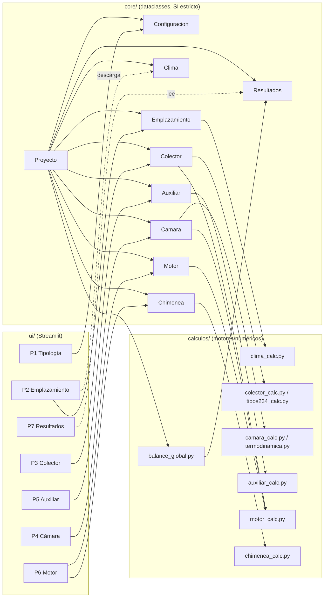
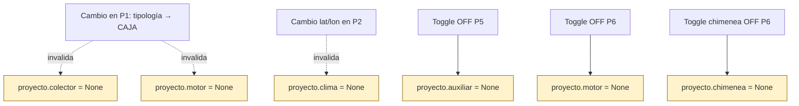
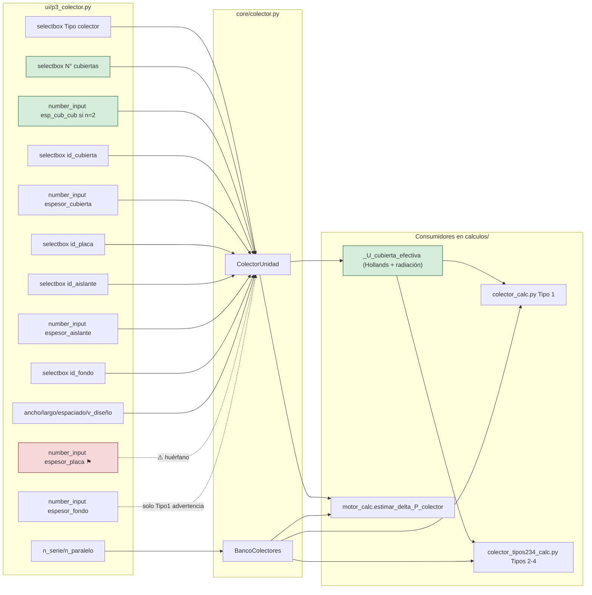
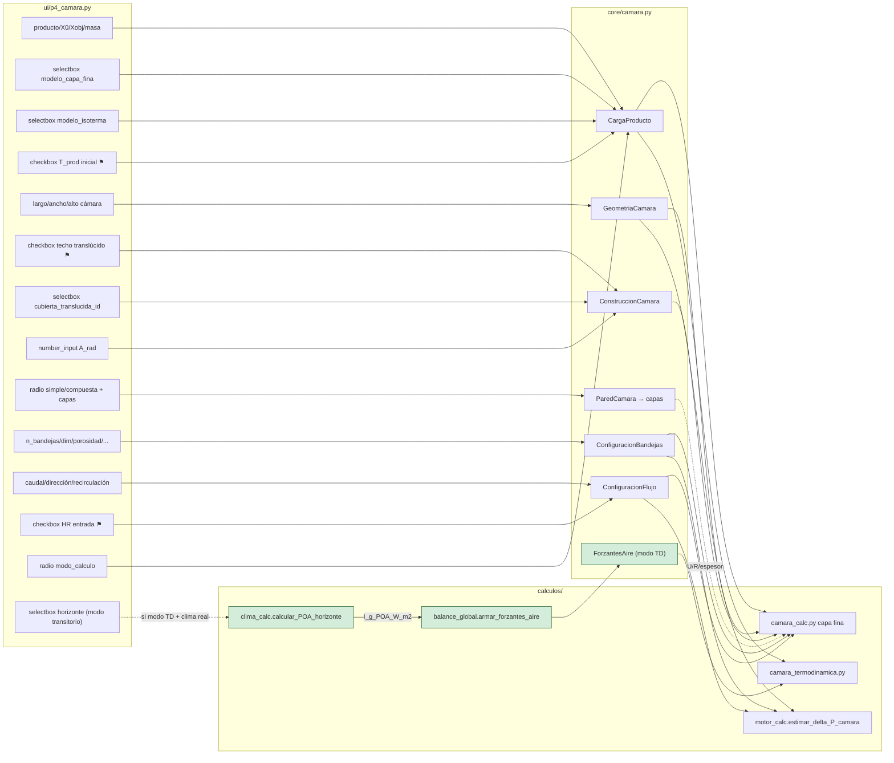
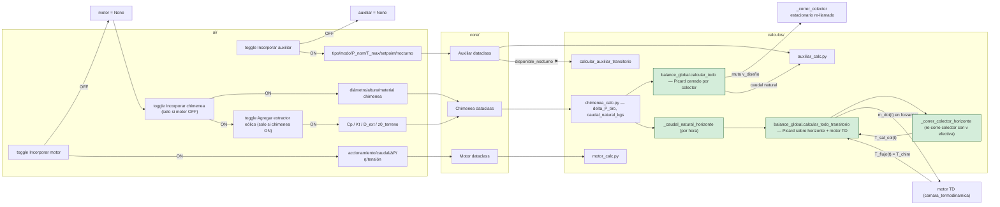

# Mapa de conexiones — Secasol

> Documento auto-generado el 2026-05-19 (revisado al cierre de S30 extendida, 2026-05-20).
> Objetivo: detectar **widgets UI sin consumidor en `calculos/`** y **campos consumidos sin widget UI** (toggles/inputs huérfanos).

---

## Resumen ejecutivo

Una desconexión real (eran 3 a inicio de S30):

| # | Widget UI | Campo escrito | Estado |
|---|-----------|---------------|--------|
| 1 | "Espesor placa absorbedora [mm]" (P3) | `proyecto.colector.unidad.espesor_placa_m` | ⚠️ No es leído por ningún cálculo térmico (se asume capacitancia despreciable). Decisión consciente de no incorporar capacitancia de placa por ahora. |

**Corregido en S30 (2026-05-19):**

- **"N° cubiertas" (P3)**: propagado a los 4 motores numéricos vía `_U_cubierta_efectiva` (Hollands + radiación gris paralela). Acompañó la corrección de dos bugs preexistentes en los signos del residual `_sistema_nodo` (F1 en los 4 tipos, F3 en Tipo 1) que producían raíces espurias con `T_cub_e` físicamente imposibles. Ver `validacion/validacion_hwb.py`.
- **F4 Tipos 2/3/4**: agregado el término convectivo `conv_ci_int = h·(T_int − T_f_ci)·W_abs` al balance de la cara interna del fondo, restaurando coherencia local con la EDO del fluido inferior (que ya lo cobraba). Ver `validacion/comparar_f4.py`.
- **Chimenea solar**: el huérfano se cerró completo en 4 pasos. (a) Nuevo `calculos/chimenea_calc.py` con `delta_P_tiro_Pa`, `delta_P_chimenea_Pa`, `caudal_natural_kgs` (tiro térmico + brentq sobre equilibrio). (b) Migrada estructuralmente de `Colector` a `Proyecto` top-level (nuevo `core/chimenea.py`) para que también aplique a tipología CAJA. (c) UI propia en **P6** (Motor), accesible cuando el toggle de motor está OFF. (d) Integrada en `balance_global.calcular_todo`: cuando motor=None y chimenea presente, el caudal natural reemplaza al caudal manual de la cámara durante la simulación (try/finally restaura).

**Completado en S30 extendida (2026-05-19/20)** — cierre físico completo del lazo natural:

- **Visualización en P7 modo constantes**: panel dedicado, tabla expander con 8 filas, warning explícito si desviación |ṁ_nat − ṁ_design|/ṁ_design > 30 %, snapshots `.txt`/`.json` con bloque chimenea.
- **Picard cerrado por el colector en modo constantes**: `calcular_todo` itera T_chim ↔ ṁ_nat ↔ T_salida_colector mutando `velocidad_diseno_ms` del colector en cada paso (try/finally restaura). 10 iter máx, tol 0.5 K. Demo: converge en 7 iter; ṁ_nat ~55 % menor que el single-pass original (que sobreestimaba con v de diseño).
- **Acople transitorio con motor TD**: `calcular_todo_transitorio` corre Picard sobre el horizonte (5 iter máx). `m_dot_aire_seco_kg_s` ya era array en `ForzantesAire`; el motor TD interpola por t. Auxiliar transitorio recibe ṁ promedio del horizonte (limitación de primer orden documentada). `ResultadosCompletosTransitorio.chimenea` poblado con series horarias.
- **Re-corrida del colector hora a hora**: nuevo `_correr_colector_horizonte` itera el solver del colector cada hora con v efectiva `ṁ_nat(t) / (ρ · A_canal · n_par)`. Cambia T_sal_col(t) ~−15 °C respecto a la forzante UI precomputada con velocidad de diseño (en escenarios donde ṁ_nat ≠ ṁ_design).
- **POA precomputada en `ForzantesAire`**: nuevo campo `I_g_POA_W_m2` (opcional). Helper compartido `calculos/clima_calc.calcular_POA_horizonte` aplica transposición Liu-Jordan con pvlib (mismo modelo que P3, ahora deduplicado). P4 puebla la POA desde clima real; el sugerido de I_g en P7 modo constantes ahora sale de quantile 90 de POA. Si POA no está disponible (forzante sintética, clima incompleto), el balance global cae a GHI con aviso explícito `ADV_PICARD_POA_NO_DISPONIBLE`.

Todas las demás conexiones revisadas (toggles de auxiliar, motor, cubierta translúcida, pared compuesta, HR de entrada, T_prod inicial, etc.) están correctamente cableadas.

---

## Diagrama 1 — Arquitectura general (3 capas)

**Regla arquitectónica**: `core/` y `calculos/` no importan `streamlit`. Toda conversión de unidades (°C↔K, %↔fracción, Duffie↔pvlib) ocurre en `ui/componentes/unidades.py`.

---

## Diagrama 2 — Cascada de invalidación

---

## Diagrama 3 — P3 Colector (estado final S30)

**Hallazgos P3 (actuales)**:
- `n_cubiertas` + `espaciado_entre_cubiertas_m`: ✓ Conectados a los 4 motores numéricos vía `_U_cubierta_efectiva` (corrección S30, 2026-05-19). La doble cubierta agrega resistencia serie cubierta–cavidad–cubierta usando Hollands + radiación entre superficies grises paralelas.
- `espesor_placa_m`: ⚠️ Configurable pero no entra al balance térmico. El modelo asume capacitancia despreciable de la placa.
- **Chimenea**: ya no está en P3. Se migró a `Proyecto.chimenea` (top-level, definida en `core/chimenea.py`) y su UI vive en P6.

---

## Diagrama 4 — P4 Cámara

**Hallazgos P4 (estado al cierre de S30 extendida)**:

- Todas las conexiones de cámara (dataclasses → solvers) cableadas correctamente. La pared compuesta se consume vía métodos agregados (`U_conduccion_W_m2K`, `R_conduccion_m2K_W`, `espesor_total_m`) en `camara_calc.py:735`.
- **Modo transitorio**: P4 arma `ForzantesAire` desde el clima horario real. Ahora la forzante incluye **dos series de irradiancia separadas**:
  - `I_g_W_m2`: GHI sobre el techo de la cámara (input al motor termodinámico de cámara para Q_rad por techo translúcido).
  - `I_g_POA_W_m2`: POA sobre el plano del colector (input a `_correr_colector_horizonte` cuando el lazo natural por chimenea está activo). Calculada con `calculos.clima_calc.calcular_POA_horizonte` (transposición Liu-Jordan con pvlib, mismo modelo que P3).
- Si DNI/DHI no están disponibles (clima incompleto, modo sintético), POA queda en `None` y el balance global cae a GHI con aviso explícito `ADV_PICARD_POA_NO_DISPONIBLE`.

---

## Diagrama 5 — P5 Auxiliar + P6 Motor / Chimenea (toggles raíz)

**Hallazgos P5/P6 (estado al cierre de S30 extendida)**:

- Toggle `disponible_nocturno` del auxiliar solo afecta al modo transitorio (`calcular_auxiliar_transitorio`); en modo cuasi-estacionario es ignorado — comportamiento esperado.
- Chimenea en P6 (sólo si motor OFF): estructuralmente coexisten en el dataclass, son mutuamente excluyentes desde la UI.
- **Lazo natural cerrado en ambos modos** (S30 extendida):
  - *Constantes*: Picard `T_chim ↔ ṁ_nat ↔ T_sal_col` en `calcular_todo`. Re-corre el colector estacionario mutando `velocidad_diseno_ms`. 10 iter máx, tol 0.5 K. Try/finally restaura.
  - *Transitorio*: Picard sobre todo el horizonte en `calcular_todo_transitorio`. Por iteración: `_caudal_natural_horizonte` calcula ṁ(t) hora a hora; `_correr_colector_horizonte` re-corre el colector cada hora con v efectiva; motor TD consume las nuevas forzantes; `T_flujo(t)` realimenta T_chim(t). 5 iter máx, tol 0.5 K.
- **POA correcta en el solver del colector**: en ambos pipelines la radiación que entra al solver del colector es POA (no GHI). Ver §101 de la bitácora y diagrama 4 abajo.

---

## Tabla maestra — widget → campo → consumidor

| Pestaña | Widget UI | Campo `Proyecto.*` | Leído por |
| ------- | --------- | ------------------- | --------- |
| P1 | tipología (radio) | `configuracion.tipologia` | `balance_global` |
| P1 | modo_analisis | `configuracion.modo_analisis` | `balance_global` |
| P1 | dia_analisis | `configuracion.dia_analisis` | UI únicamente (P2 selección de fecha) |
| P2 | latitud/longitud | `emplazamiento.lat/lon_deg` | `clima_calc.obtener_clima` |
| P2 | altitud | `emplazamiento.altitud_m` | UI (display) |
| P2 | acimut/pendiente | `emplazamiento.acimut/pendiente` | `solar_geometria` (vía emplazamiento) |
| P2 | zona_horaria | `emplazamiento.zona_horaria` | `solar_geometria` |
| P3 | N° cubiertas ⚑ | `colector.unidad.n_cubiertas` + `espaciado_entre_cubiertas_m` | `colector_calc`, `tipos234_calc` (vía `_U_cubierta_efectiva`) |
| **P3** | **Espesor placa** ⚑ | `colector.unidad.espesor_placa_m` | **⚠️ ninguno** |
| P3 | id_cubierta/espesor_cubierta | `colector.unidad.*` | `colector_calc`, `tipos234_calc` |
| P3 | id_placa | `colector.unidad.id_placa` | `colector_calc`, `tipos234_calc`, `motor_calc` (rugosidad) |
| P3 | id_aislante/espesor_aislante | `colector.unidad.*` | `colector_calc`, `tipos234_calc` |
| P3 | id_fondo | `colector.unidad.id_fondo` | `tipos234_calc` (no Tipo 1) |
| P3 | geometría + banco | `colector.unidad/banco.*` | `colector_calc`, `tipos234_calc`, `motor_calc` |
| P4 | producto/X/masa/modelos | `camara.carga_producto.*` | `camara_calc`, `camara_termodinamica` |
| P4 | T_prod inicial | `camara.carga_producto.T_prod_inicial_K` | `camara_termodinamica` |
| P4 | geometría cámara | `camara.geometria.*` | `camara_calc`, `motor_calc` |
| P4 | techo translúcido + A_rad | `camara.construccion.*` | `camara_calc`, `camara_termodinamica` |
| P4 | pared compuesta (capas) | `camara.construccion.pared.capas` | `camara_calc` (vía métodos U/R) |
| P4 | bandejas (todo) | `camara.bandejas.*` | `camara_calc`, `motor_calc` |
| P4 | caudal/dirección/recirc/HR | `camara.flujo.*` | `camara_calc`, `motor_calc` |
| P4 | modo_calculo | `camara.modo_calculo` | `camara_calc` (selección de rama) |
| P4 | batches_por_mes (slider, solo ANUAL) | `camara.operacion_anual.batches_por_mes` | `operacion_anual_camara.calcular_operacion_anual_camara` (escala mensual) |
| P4 → P7 | `ResultadosAnualCamara` (session_state) | `st.session_state["p4_resultado_anual"]` | `p7_resultados._render_operacion_anual_detalle` (tabla + barras 12 meses) |
| P5 | tipo/modo/P_nom/setpoint/T_max/η_quem/PCI | `auxiliar.*` | `auxiliar_calc` |
| P5 | disponible_nocturno ⚑ | `auxiliar.disponible_nocturno` | `calcular_auxiliar_transitorio` |
| P5 | tipo_biomasa/PCI/η | `auxiliar.*` | `auxiliar.consumo_biomasa_efectivo_kg_h()` |
| P6 | accionamiento/caudal/ΔP/η/factor | `motor.*` | `motor_calc`, `Motor.__post_init__` |
| P6 | chimenea (D, H, material) | `proyecto.chimenea.*` (top-level) | `chimenea_calc.{delta_P_tiro_Pa, caudal_natural_kgs}`, `balance_global._caudal_natural_loop` (constantes) y `_caudal_natural_horizonte` + `_correr_colector_horizonte` (transitorio, dentro de Picard) |
| P6 | extractor eólico en chimenea (`extractor_activo`, `diametro_extractor_m`, `Cp_turbina`, `Kt_turbina`, `z0_terreno_m`) | `proyecto.chimenea.{extractor_activo, ...}` | `chimenea_calc.{delta_P_turbina_motriz_Pa, _v_viento_a_altura, caudal_natural_kgs}` (motriz + Kt + perfil log de viento). Propagado a `_caudal_natural_loop`/`_caudal_natural_horizonte` con `v_viento_10m_ms` desde forzantes |
| P4→core | I_g_POA(t) sobre plano colector | `forzantes_base.I_g_POA_W_m2` (transitorio) | `balance_global._correr_colector_horizonte` → `_correr_colector` → `colector_calc`/`tipos234_calc` |
| P4→core | GHI(t) sobre techo cámara | `forzantes_base.I_g_W_m2` (transitorio) | `camara_termodinamica.simular_secado` (Q_rad por techo translúcido) |
| (interno) | POA representativa anual (sugerido P7) | — | `ui/p7_resultados._sugerir_condiciones` → `calcular_POA_horizonte` (quantile 90) |

---

## Recomendaciones

Pendientes:

1. **`espesor_placa_m`**: documentar explícitamente que el modelo asume capacitancia térmica de la placa despreciable, o incorporar el término al EDO si la masa de la placa es relevante.
2. **A_rad configurable desde P4** (hoy default a `area_bandeja_m2` superior). Heredado de S29.
3. **α_solar por producto** en `frutas.yaml`/`hortalizas.yaml` (default 0.6). Heredado de S29.

✓ **Resueltos en S30 (2026-05-19):**

- **`n_cubiertas`** conectada a los 4 motores numéricos vía `_U_cubierta_efectiva`, junto con `espaciado_entre_cubiertas_m`.
- **Bugs preexistentes de signos** en F1 (los 4 tipos) y F3 (Tipo 1) del residual algebraico — raíz espuria con `T_cub_e ≈ −200 °C`. Validado contra HWB con R²=1.0000.
- **F4 Tipos 2/3/4**: incoherencia entre EDO del fluido ci y balance del fondo corregida agregando `conv_ci_int` explícito.
- **Chimenea solar**: cerrado el ciclo huérfano → modelo (`chimenea_calc.py`), migración a `Proyecto` top-level, UI propia en P6, integración del caudal natural en `balance_global` (single-pass).

✓ **Resueltos en S30 extendida (2026-05-19/20)** — completan el cierre físico del lazo natural:

- **Visualizar `res.chimenea` en P7 modo constantes**: panel, tabla, snapshots `.txt`/`.json` y warning explícito si la desviación |ṁ_nat − ṁ_design|/ṁ_design > 30 %.
- **Iterar T_chim ↔ ṁ_nat ↔ T_salida_colector** (Picard cerrado por el colector) en `calcular_todo` (modo constantes). 10 iter máx, tol 0.5 K. Mutación temporal de `velocidad_diseno_ms` con `try/finally`.
- **Acople con motor termodinámico de cámara** en pipeline transitoria (`calcular_todo_transitorio`): Picard sobre el horizonte completo (5 iter máx). `ResultadosCompletosTransitorio.chimenea` con series horarias. UI: Panel 5 de chimenea con ṁ(t), T_chim(t), ΔP_tiro(t).
- **Re-correr el colector hora a hora** dentro del Picard transitorio: nuevo `_correr_colector_horizonte` itera el solver estacionario con v efectiva impuesta por el ṁ_nat de cada hora. Coherencia energética en `energia_solar_util_MJ` con las series re-calculadas.
- **POA precomputada en `ForzantesAire`**: nuevo campo `I_g_POA_W_m2` opcional + helper compartido `calculos.clima_calc.calcular_POA_horizonte` (transposición Liu-Jordan con pvlib). P4 puebla la POA desde clima real. P3 deduplicado (su `_poa_serie` ahora es wrapper del helper). Sugerido de I_g en P7 modo constantes ahora sale de quantile 90 de POA. Fix del bug físico: los 4 solvers de colector reciben POA en todos los caminos (P3 horario/diario, P3/P7 constantes, P7 transitorio con clima). Fallback a GHI con aviso `ADV_PICARD_POA_NO_DISPONIBLE` sólo en forzantes sintéticas o clima sin DNI/DHI.

Ver `docs/bitacora/bitacora_sesion30.md` (§84-§101) y `validacion/{validacion_hwb,comparar_f4}.py`. Suite al cierre: **774 + 2 xfailed** (era 717 + 2 al cierre de S29; +57 tests netos en la sesión extendida).

---

## Cómo regenerar este mapa

Este documento se construyó con tres pasadas de exploración paralela:

- Inventario de dataclasses en `core/`
- Asignaciones `proyecto.* = ...` en `ui/p*.py`
- Lecturas `proyecto.*` / `colector.*` en `calculos/*.py`

Luego se cruzaron por nombre de campo y se verificaron los huérfanos sospechosos con `grep`. Pedile a Claude que regenere si hubo cambios estructurales (renombres, nuevos dataclasses, nuevos motores).
